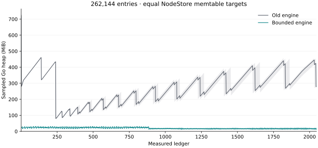

# Bounded state execution: optimized comparison

The optimized engine substantially reduces retained state memory, but it remains slower than the old engine in these workloads. Median mean signed acceptance is **+26.2%** for the small Batch and **+4.2%** for 32 Batches / 256 inner payments. Ordinary durable-state cases take **1.84–2.29×** the old time; forced spilling takes **3.01×**, versus **15.97×** in the initial comparison. Larger-state sampled heap is **92–93% lower** and whole-process peak RSS **45–54% lower** in the original suite. These results improve the tradeoff; they do not establish performance parity or close the production performance gate.

The [initial comparison](state-memory-initial.md) remains available with its original raw data. This report compares the optimized implementation directly with the same old engine, rather than treating improvement over the first bounded implementation as a speedup over the old engine.

## Method and boundaries

Old execution is pinned to `546e974024a77d9dcf80bc07cd4e86930467fff1`; optimized execution is pinned to `8f6b85ac9`. Both source harnesses and worktree patches are archived. Measurements ran on 2026-10-13 on an Apple M3 Pro (11 cores, 18 GiB RAM), Darwin arm64, Go 1.24.4, with `GOMAXPROCS=4`, `GOGC=100`, and `GOMEMLIMIT=512MiB`. The host is an interactive laptop. Processes ran serially, with before/after order reversed between successive pairs; local builds and tests were stopped during timing. The OS page cache was not cleared.

The six workloads, five independent process pairs, and original iteration counts are unchanged. Service measurements contain 200 acceptances per process, either one signed Batch with two inner payments or 32 signed Batches with 256 inner payments. Acceptance includes parsing, application, close/commitment, successor preparation and persistence queueing; it excludes the asynchronous durable writer. Process RSS and CPU include fixture setup and teardown, which differ substantially between implementations and are outside acceptance timing.

State workloads seed identical hashed keys with 512-byte values, persist them, then reopen root-backed views. This drops decoded setup trees without flushing storage or OS caches. They use these original settings:

| Workload | Initial entries | Measured ledgers | Warmup | Reads/ledger | Writes/ledger | Retained views |
| --- | ---: | ---: | ---: | ---: | --- | ---: |
| Hot | 4,096 | 512 | 16 | 128 | Update 16 keys | 32 |
| Disjoint | 65,536 | 1,024 | 0 | 512 | Update 16 keys | 64 |
| Growing | 32,768 | 512 | 16 | 128 | Insert 64 keys | 32 |
| Spill | 4,096 | 256 | 16 | 128 | Update 512 keys | 32 |

State total latency includes successor opening, reads, writes, close, canonical persistence and synchronization. Bounded execution additionally verifies the committed closure, computes a root diff, advances the flat database durably, and acknowledges the outbox. It excludes SQL/header publication, transaction parsing/application, networking, and service-level scheduling. The benchmark materializes its per-ledger diff in test-owned slices before flat publication; production consumes a streaming diff. Harness allocations are included in runtime metrics but are outside managed execution accounts.

Current-record outbox cleanup changed deliberately: after dependent publication is durable, `AckPublishedOutbox` can delete a record matching the full current descriptor without another fsync. A crash can resurrect that cleanup record and trigger idempotent replay. The durable current descriptor retains its roots, and the next descriptor transition syncs the deletion. Older, mismatched or uncertain records still require synchronous deletion. Canonical nodes, flat publication, SQL and the validated tip retain their durability boundaries. The initial benchmark included a separate synchronous cleanup for every record.

## Resources

Block-cache allowances remain equal in total: service uses old 256 KiB versus new 128 KiB NodeStore + 128 KiB flat; state uses old 16 MiB versus new 8 MiB + 8 MiB. These are small-cache fixtures, not production-default configurations. Memtable policy changed and must be considered alongside the cache allowances:

| Resource | Old | Optimized |
| --- | --- | --- |
| NodeStore memtable target in these fixtures | 64 MiB | 8 MiB |
| NodeStore accounted ceiling, service (two generations) | 512.25 MiB | 64.125 MiB |
| NodeStore accounted ceiling, state (one generation) | 272 MiB | 40 MiB |
| Flat memtable requested/effective, service | None | 8 / 1 MiB |
| Flat memtable requested/effective, state | None | 4 / 2 MiB |

NodeStore reserves one shared block cache plus four memtables per generation. Its target is `min(64 MiB, max(8 MiB, cache/2))`; default 256 MiB cache therefore retains the original 64 MiB target. Flat target is `min(requested, max(1 MiB, cache/4))`. Pebble reserves memtable arenas against its block cache, so a configured block-cache capacity is not a guaranteed amount available for cached reads. These accounting ceilings are not RSS measurements.

State workspace remains 64 MiB; overlay memory remains 1 MiB, or 64 KiB for forced spill; scratch disk remains 64 MiB. The original workload budgets were not enlarged. The old engine has no equivalent execution-memory or spill bound. Runtime allocation and heap samples include garbage awaiting collection; no forced GC runs during measurements.

## Acceptance

Median of five per-run values; milliseconds unless stated otherwise.

| Workload | Metric | Old | Optimized | Change |
| --- | --- | ---: | ---: | ---: |
| Batch / 2 inner payments | Mean acceptance | 1.150 | 1.452 | +26.2% |
| Batch / 2 inner payments | p50 | 1.048 | 1.264 | +20.5% |
| Batch / 2 inner payments | p95 | 1.793 | 1.958 | +9.2% |
| Batch / 2 inner payments | p99 | 2.121 | 3.181 | +50.0% |
| Batch / 2 inner payments | Allocated bytes/acceptance | 747838 | 785759 | +5.1% |
| 32 Batches / 256 inner payments | Mean acceptance | 79.967 | 83.297 | +4.2% |
| 32 Batches / 256 inner payments | p50 | 79.225 | 82.644 | +4.3% |
| 32 Batches / 256 inner payments | p95 | 85.939 | 90.851 | +5.7% |
| 32 Batches / 256 inner payments | p99 | 89.545 | 95.337 | +6.5% |
| 32 Batches / 256 inner payments | Allocated bytes/acceptance | 64082310 | 67868239 | +5.9% |

Per-run mean ranges (observed ranges, not confidence intervals): Batch / 2 inner payments: 1.139–1.203 ms old and 1.348–1.546 ms optimized. 32 Batches / 256 inner payments: 79.352–80.232 ms old and 83.097–85.970 ms optimized.

Whole-process peak RSS, including setup: Batch / 2 inner payments: 43.8 → 47.3 MiB. 32 Batches / 256 inner payments: 94.3 → 73.2 MiB. The short acceptance fixtures do not demonstrate a retained-memory reduction. Optimized runs reported 18 flat hits and 7 authenticated-root fallbacks per acceptance; newly closed roots are accessed before asynchronous flat advancement.

Median phase p50, old → optimized (milliseconds):

| Workload | Parse | Apply | Close / commitment | Prepare successor |
| --- | ---: | ---: | ---: | ---: |
| Batch / 2 inner payments | 0.199 → 0.213 | 0.467 → 0.494 | 0.042 → 0.111 | 0.285 → 0.374 |
| 32 Batches / 256 inner payments | 12.865 → 12.573 | 43.102 → 43.874 | 0.104 → 1.197 | 22.970 → 24.502 |

## Cache-size check

A separate five-pair diagnostic uses 32 MiB total block cache (old: 32 MiB NodeStore; optimized: 16 MiB NodeStore + 16 MiB flat), with 50 acceptances per process. Signed workload, production code, execution admission limits and durability are unchanged. This is an additional configuration, not a replacement for the original 256 KiB results above. The benchmark-only cache option is included in the measured revision.

| Workload | Old mean (ms) | Optimized mean (ms) | Change |
| --- | ---: | ---: | ---: |
| Batch / 2 inner payments | 1.065 | 1.366 | +28.3% |
| 32 Batches / 256 inner payments | 78.911 | 82.919 | +5.1% |

With the larger cache, the small case remains +28.3% and the large case +5.1%. The regression is not explained by the original tiny block-cache allowance alone. This diagnostic has fewer acceptances per process; its absolute timings should not replace the original comparison.

## Larger retained working set, equal NodeStore memtables

This additional case was selected before measurement: 262,144 initial entries, 2,048 ledgers, 512 reads and 16 updates per ledger, and 64 retained views. Its read schedule touches all initial keys. Three process pairs use 256 MiB total block cache (old: 256 MiB NodeStore; optimized: 128 MiB NodeStore + 128 MiB flat). Both revisions therefore use the same 64 MiB NodeStore memtable target; the new flat store additionally uses 4 MiB memtables. The 512 MiB Go soft memory limit, 64 MiB workspace, 1 MiB overlay and 64 MiB scratch allowance remain unchanged. This is an additional configuration, not a replacement for the original small-cache cases.

| Metric | Old | Optimized | Change |
| --- | ---: | ---: | ---: |
| Mean durable workload (ms) | 6.561 | 11.242 | +71.4% |
| p95 durable workload (ms) | 8.992 | 15.026 | +67.1% |
| p99 durable workload (ms) | 11.894 | 22.029 | +85.2% |
| Last-quarter sampled heap (MiB) | 363.6 | 16.5 | -95.5% |
| Whole-process peak RSS (MiB) | 1177.3 | 736.6 | -37.4% |
| Allocated KiB/ledger | 1121 | 1167 | +4.1% |
| GC CPU (seconds/run) | 0.959 | 0.435 | -54.7% |
| GC cycles/run | 19 | 190 | +900.0% |
| Whole-process wall time (seconds) | 18.77 | 48.37 | +157.7% |
| Final node + flat files (MiB) | 475.3 | 616.5 | +29.7% |

The retained-memory reduction persists when NodeStore memtable targets match. GC CPU is lower in this larger case, although total durable latency is still higher. Setup materializes a full initial SHAMap and clones initial changes outside the timed ledger loop; whole-process wall time and peak RSS include that setup and are not steady-state memory limits. No forced GC is performed during measurement. All 12,288 per-ledger identities match, flat advancement succeeds without fallback or backlog, and all managed account peaks stay within their allowances. This case does not exercise online-delete rotations or establish a production memory plateau.



The plot shows the median of three runs at each ledger, with the observed minimum-to-maximum range shaded. Samples include garbage awaiting collection; the plot is not post-GC live heap or process RSS.

## Durable state workloads

Median of five per-run values; arrows are **old → optimized**.

| Workload | Mean total (ms) | p50 (ms) | p95 (ms) | p99 (ms) | Ratio | Initial ratio |
| --- | ---: | ---: | ---: | ---: | ---: | ---: |
| Hot | 4.48 → 9.65 | 4.55 → 9.73 | 6.00 → 12.54 | 6.95 → 15.63 | 2.15× | 4.66× |
| Disjoint | 5.62 → 10.37 | 5.10 → 10.05 | 8.08 → 14.15 | 10.71 → 17.34 | 1.84× | 4.36× |
| Growing | 6.28 → 14.37 | 5.98 → 13.55 | 8.97 → 20.05 | 11.83 → 24.10 | 2.29× | 4.15× |
| Spill, 64 KiB overlay | 9.95 → 29.96 | 9.84 → 28.40 | 13.84 → 44.37 | 16.85 → 51.44 | 3.01× | 15.97× |

Initial ratios come from the earlier measurement session; compare each revision with its own paired baseline. Absolute latencies across sessions are not controlled speedup measurements. The forced-spill case measures a deliberately tight 64 KiB allowance against the old unconstrained engine.

| Workload | Last-quarter sampled heap (MiB) | Process peak RSS (MiB) | Allocated KiB/ledger | GC CPU (s/run) | GC cycles/run |
| --- | ---: | ---: | ---: | ---: | ---: |
| Hot | 11.4 → 3.4 | 72.0 → 66.0 | 478 → 592 | 0.18 → 0.37 | 33 → 145 |
| Disjoint | 106.0 → 7.0 | 492.3 → 269.8 | 921 → 1120 | 0.26 → 0.56 | 10 → 255 |
| Growing | 98.7 → 7.5 | 326.2 → 151.2 | 1403 → 1808 | 0.21 → 0.43 | 14 → 192 |
| Spill, 64 KiB overlay | 51.4 → 8.0 | 273.0 → 67.6 | 7056 → 10343 | 0.58 → 2.07 | 72 → 646 |

Both the execution architecture and the lower NodeStore memtable targets contribute to the memory result. Lower retained heap does not imply fewer allocations: in these four cases, allocation and GC overhead remain higher. Peak RSS includes seeding and storage-engine memory; sampled Go heap is not post-GC live heap.

| Workload | Logical node fetches/ledger | Canonical KiB stored/ledger, both sides | Final node + flat files (MiB) | Peak scratch (KiB), optimized |
| --- | ---: | ---: | ---: | ---: |
| Hot | 4.4 → 165.0 | 34.0 | 21.7 → 43.6 | 0.0 |
| Disjoint | 87.2 → 213.0 | 42.8 | 135.6 → 164.7 | 0.0 |
| Growing | 73.1 → 615.7 | 129.3 | 143.6 → 162.0 | 0.0 |
| Spill, 64 KiB overlay | 6.8 → 3246.0 | 565.3 | 195.3 → 224.6 | 249.0 |

Optimized phase timings, median of per-run means in milliseconds (medians need not sum exactly):

| Workload | Read | Write | Close / build | Node persistence | Root diff | Flat publication + cleanup |
| --- | ---: | ---: | ---: | ---: | ---: | ---: |
| Hot | 1.28 | 0.16 | 1.27 | 2.97 | 0.51 | 3.36 |
| Disjoint | 3.46 | 0.06 | 0.66 | 3.07 | 0.24 | 2.86 |
| Growing | 0.88 | 0.52 | 3.28 | 3.19 | 2.98 | 3.51 |
| Spill, 64 KiB overlay | 0.60 | 7.60 | 7.98 | 3.41 | 5.39 | 5.03 |

The old engine writes dirty canonical nodes during its persistence phase, whereas bounded execution writes them while constructing the commitment. Phase timings therefore locate work within each implementation; they are not isolated comparisons of identical functions. Logical fetch/store counts exclude flat database lookups. File sizes include seeded data, WALs and compaction files and do not measure physical write amplification.

## Changes and verification

- Reuse at most two leased flat snapshots, retiring them safely when the descriptor advances; preserve owned-byte public reads while eliminating internal copies.
- Stream empty-subtree construction directly, including singleton leaves; avoid repeated descent and copying through all 64 key nibbles. Emit canonical bytes through the same encoders used by existing SHAMap nodes, avoiding temporary mutable nodes and item copies. Diagnostic hash formatting no longer causes successful paths to allocate escaping hash arrays.
- Batch canonical writes and flush admitted output before waiting for additional workspace; prevent missed wakeups under memory pressure.
- Retain exact transaction payload totals from locally built commitments for successor sizing. Imported or changed-base trees still traverse authenticated nodes; cancellation and overflow checks remain active.
- Reuse exclusively owned overlay tree paths and rotation pivots. Shared ancestry still forces copying; fallible allocations finish before private ancestors change. No-op writes succeed even at the account limit.
- Buffer scratch writes within the existing account, bound shared file descriptors, and reject truncated record headers. During commitment, optional read windows of at most 32 KiB per cursor use the existing workspace; required-memory pressure evicts them before any wait. Values remain owned across eviction and refill. Scratch files remain process-lifetime data.
- Keep the flat transition marker before actual chunked mutation; synchronize the final descriptor/outbox batch after intermediate WAL writes. Small transitions remain one atomic batch. Current-record outbox cleanup follows the replay contract above.
- Size storage memtables from configured cache allowances, with measured floors to avoid excessive flush/compaction work.

All 60 original-comparison processes passed: 4,000 measured signed acceptances and 23,040 measured state ledger steps. Every state sequence, root, ledger hash and rolling read digest matched across revisions and repetitions; service fixtures checked fixed hashes, transaction counts, metadata and effects. All bounded state runs used flat reads with zero fallback, failures or pending outbox records, advanced once per ledger, and respected workspace, overlay and scratch allowances. All spill runs used scratch disk. These checks establish cross-revision agreement, not an independent protocol oracle.

Full repository tests with the required conformance corpus, affected ledger/service/overlay/flatstate/SHAMap/Pebble race suites, and strict/advisory lint passed. The pushed production checkpoint `8f6b85ac9` passed all required hosted CI checks, including PostgreSQL, native MPT, pinned corpus and rippled peer/consensus interop. Failure/recovery tests cover marker replay, lost unsynchronized cleanup, older-record retention, cancellation, bounded cursor pressure, and physical rotation/reopen.

These fixtures do not establish mainnet TPS, a production RSS ceiling, or a long-running production soak. The rotation test demonstrates ownership and recovery correctness across six physical rotations and 96 closes; it is not a performance soak. All remaining regressions are reported, including the additional flat durability cost and forced spill overhead.

## Evidence and reproduction

Raw data: [service runs](state-memory-optimized-results/service-runs.json), [state runs](state-memory-optimized-results/state-runs.json.gz), [state summary](state-memory-optimized-results/state-summary.csv), [cache diagnostic](state-memory-optimized-results/cache-runs.json), and [raw logs, exact harnesses and patches](state-memory-optimized-results/raw-evidence.tar.gz). The larger retention case is in [retained-state runs](state-memory-optimized-results/retained-runs.json.gz). See [aggregation definitions](state-memory-optimized-results/README.md).

Create separate worktrees at the measured revisions, then install the archived baseline harness. Use Go 1.24.4 and Python 3.9+ with `os.wait4` (macOS or Linux), configured with the repository's native dependencies:

```sh
git worktree add --detach /tmp/state-before 546e974024a77d9dcf80bc07cd4e86930467fff1
git worktree add --detach /tmp/state-after 8f6b85ac9
tar -xzf docs/performance/state-memory-optimized-results/before-harness.tar.gz -C /tmp/state-before
python3 /tmp/state-after/scripts/benchmark-state-memory.py --before-tree /tmp/state-before --after-tree /tmp/state-after --manifest /tmp/state-after/scripts/benchmarks/state-memory/service.json --output /tmp/service-results --samples 5
python3 /tmp/state-after/scripts/benchmark-state-memory.py --before-tree /tmp/state-before --after-tree /tmp/state-after --manifest /tmp/state-after/scripts/benchmarks/state-memory/state.json --output /tmp/state-results --samples 5
```

Use fresh output directories. The runner compiles before timing, alternates pair order, archives source hashes and patches, records binary hashes/process metrics, and stops on failed runs or differing state identities. For the cache check, use the same after revision, install [cache-before-harness.tar.gz](state-memory-optimized-results/cache-before-harness.tar.gz) into the baseline worktree, and pass [cache-manifest.json](state-memory-optimized-results/cache-manifest.json). All comparisons use the same production revision. For the larger retention case, pass [retained-manifest.json](state-memory-optimized-results/retained-manifest.json) with `--samples 3`.
